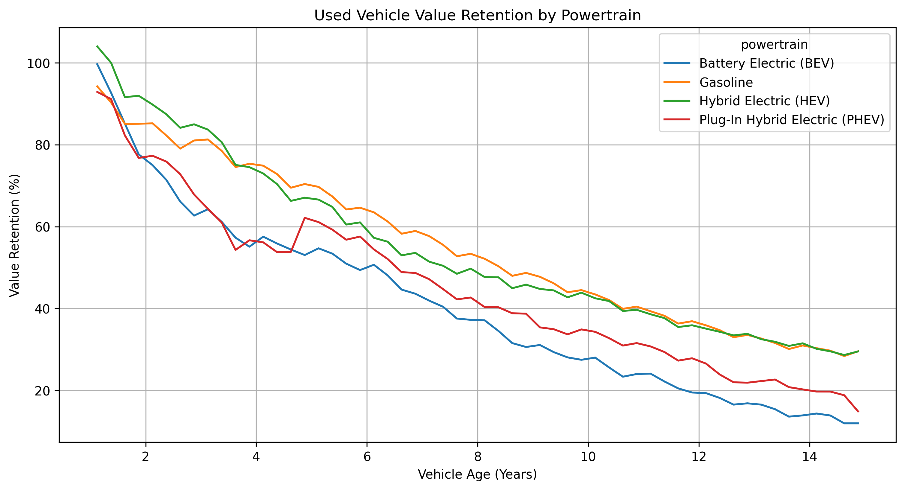
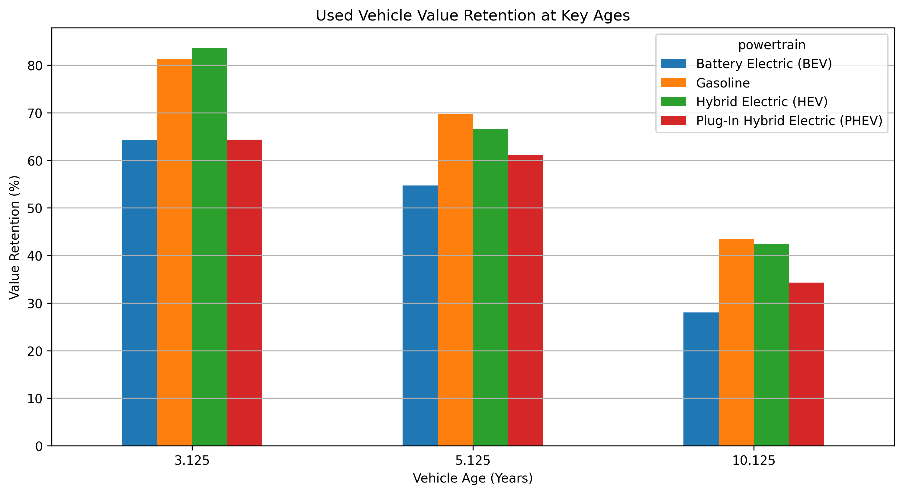

# Used Car Depreciation and Value Retention Analysis

## Project Overview

As electric and hybrid vehicles become increasingly prevalent in the U.S. automotive market, used-car dealerships face challenges in accurately valuing vehicles across different powertrain categories.

This case study examines vehicle depreciation and value retention across four powertrain categories to establish preliminary valuation benchmarks that support dealership trade-in assessments and inventory acquisition decisions.

This independent data analytics portfolio project follows the six phases of the Google Data Analytics framework: Ask, Prepare, Process, Analyze, Share, and Act.

## Project Status

**Analysis Complete**

- [x] Ask — Define business objectives and project scope.
- [x] Prepare — Collect data and evaluate source credibility.
- [x] Process — Clean, transform, and validate data.
- [x] Analyze — Identify depreciation and value retention patterns.
- [x] Share — Develop visualizations and communicate findings.
- [x] Act — Provide business recommendations and identify future research opportunities.

## Business Objective

Analyze vehicle depreciation and value retention across four powertrain categories to help used-car dealerships make more informed vehicle valuation and inventory acquisition decisions.

### Business Questions

1. How does vehicle value retention vary across powertrain categories as vehicles age?
2. Which powertrains demonstrate stronger value retention at approximately 3, 5, and 10 years?
3. How do differences in depreciation translate into potential financial differences?
4. What implications do these findings have for dealership trade-in valuation and inventory acquisition decisions?

### Stakeholders

- Used-car dealership managers
- Inventory acquisition managers
- Vehicle appraisal and trade-in specialists

## Project Scope

| Category              | Scope                                   |
| --------------------- | --------------------------------------- |
| Geographic Coverage   | United States                           |
| Vehicle Market        | Used vehicles                           |
| Powertrain Categories | Gasoline, HEV, PHEV, BEV                |
| Vehicle Age Range     | Approximately 1–15 years                |
| Comparison Milestones | Approximately 3, 5, and 10 years        |
| Primary Metrics       | Median value retention and depreciation |
| Financial Analysis    | Hypothetical remaining vehicle value    |

Customer demand, inventory turnover, and actual dealership profitability are outside the scope of this analysis.

## Data Source

**US Vehicle Trends**

- [Project Website](https://vehicletrends.us/)
- [Dataset Documentation](https://pkg.vehicletrends.us/articles/datasets)
- [Original Depreciation Dataset](https://github.com/vehicletrends/vehicletrends/blob/main/data-raw/depreciation.csv)

The dataset contains aggregated vehicle value retention statistics derived from vehicle listing data.

Data credibility was evaluated using the ROCCC framework: Reliable, Original, Comprehensive, Current, and Cited.

The analysis uses aggregated age-based statistics rather than depreciation trends isolated by calendar year.

### Data Licensing and Attribution

The aggregated depreciation dataset used in this project is provided by the US Vehicle Trends research project through the `vehicletrends` R data package.

- Published summary data: [MIT License](https://pkg.vehicletrends.us/)
- Dashboard content: [CC BY-SA 4.0](https://vehicletrends.us/license)
- Original MarketCheck vehicle listings: Proprietary and not redistributable.

The visualizations and analytical findings in this case study were independently generated using publicly available summary statistics that were filtered, transformed, and analyzed in Python.

Raw and processed datasets are intentionally excluded from this repository. Users can obtain the published summary dataset directly from its original source.

### Data Source Citations

Helveston, John Paul (2025). _US Vehicle Trends Dashboard_. https://vehicletrends.us

Helveston, John Paul (2026). _vehicletrends: Data on Vehicle Trends in the USA_. R package version 0.0.3. https://github.com/vehicletrends/vehicletrends

## Tools and Technologies

| Tool               | Purpose                                                      |
| ------------------ | ------------------------------------------------------------ |
| Python             | Data processing and analysis                                 |
| Pandas             | Data exploration, filtering, transformation, and aggregation |
| Matplotlib         | Data visualization                                           |
| Jupyter Notebook   | Analytical workflow and documentation                        |
| Visual Studio Code | Development environment                                      |
| Git and GitHub     | Version control and project documentation                    |

## Data Preparation and Processing

The original dataset was explored, filtered, transformed, and validated to establish a consistent basis for comparing vehicle depreciation across powertrain categories.

### Data Processing Summary

| Metric                              | Result |
| ----------------------------------- | -----: |
| Original records                    |  6,588 |
| Processed records                   |    224 |
| Original columns                    |      5 |
| Processed columns                   |      8 |
| Powertrain categories               |      4 |
| Consistent age intervals            |     56 |
| Missing values in processed dataset |      0 |
| Duplicate age-powertrain records    |      0 |

### Processing Steps

- Evaluated dataset structure and data credibility.
- Investigated potential outliers.
- Filtered the dataset to four target powertrain categories.
- Selected median value retention statistics.
- Standardized vehicle age coverage across powertrains.
- Validated record counts, missing values, and duplicate records.
- Calculated vehicle age in years, value retention percentages, and depreciation percentages.
- Exported the processed dataset for analysis.

Detailed documentation is available in the [Data Preparation Notebook](notebooks/01_data_preparation.ipynb).

## Data Analysis

### Value Retention Across Powertrains



Vehicle value retention was compared across consistent age intervals to identify differences in depreciation patterns.

### Value Retention at Key Vehicle Ages



| Powertrain                     | ~3 Years | ~5 Years | ~10 Years |
| ------------------------------ | -------: | -------: | --------: |
| Gasoline                       |   81.28% |   69.70% |    43.44% |
| Hybrid Electric (HEV)          |   83.68% |   66.59% |    42.50% |
| Plug-In Hybrid Electric (PHEV) |   64.36% |   61.10% |    34.32% |
| Battery Electric (BEV)         |   64.23% |   54.70% |    28.02% |

The available age intervals of 3.125, 5.125, and 10.125 years were used as approximations of the selected milestones.

### Estimated Vehicle Value Comparison

Assuming an identical original vehicle price of $40,000, the following estimated remaining values illustrate the potential financial implications of depreciation differences.

| Powertrain | ~3 Years | ~5 Years | ~10 Years |
| ---------- | -------: | -------: | --------: |
| Gasoline   |  $32,510 |  $27,879 |   $17,377 |
| HEV        |  $33,474 |  $26,636 |   $17,001 |
| PHEV       |  $25,742 |  $24,441 |   $13,727 |
| BEV        |  $25,692 |  $21,880 |   $11,209 |

These values are hypothetical estimates and do not represent actual vehicle transaction prices or dealership profitability.

Detailed calculations and visualizations are available in the [Data Analysis Notebook](notebooks/02_data_analysis.ipynb).

## Key Findings

- **BEVs demonstrate the greatest depreciation at the selected milestones**, retaining only 28.02% of their original value at approximately ten years.
- **HEVs demonstrate strong early value retention**, achieving the highest retention at approximately three years (83.68%).
- **Gasoline and HEV vehicles demonstrate stronger long-term value retention**, retaining over 42% of their original value at approximately ten years.
- **PHEVs demonstrate lower value retention than conventional hybrids** at all three selected milestones.
- **Depreciation differences have meaningful financial implications.** Under the hypothetical $40,000 vehicle scenario, a five-year-old gasoline vehicle retains approximately $6,000 more in estimated value than a BEV.

## Business Recommendations

### 1. Establish Powertrain-Specific Valuation Guidelines

Incorporate vehicle age and powertrain-specific value retention benchmarks into trade-in assessments and acquisition pricing rather than applying uniform depreciation assumptions across all vehicles.

### 2. Incorporate Depreciation into Acquisition Pricing

Rather than prioritizing or excluding specific powertrain categories solely based on depreciation, dealerships should adjust acquisition offers according to expected resale values, vehicle condition, reconditioning expenses, and target gross profit.

**Proposed Acquisition Pricing Framework**

Maximum Acquisition Offer = Estimated Resale Value − Reconditioning Costs − Target Gross Profit

#### Illustrative Trade-In Scenario

| Item                                          |      Amount |
| --------------------------------------------- | ----------: |
| Estimated resale value of a five-year-old BEV |     $21,880 |
| Estimated reconditioning costs                |     −$2,000 |
| Target gross profit                           |     −$3,000 |
| **Maximum acquisition offer**                 | **$16,880** |

This hypothetical framework illustrates how depreciation benchmarks could support acquisition pricing decisions before accounting for other applicable costs.

### 3. Strengthen Vehicle Condition Assessments

Evaluate vehicle condition, mileage, repair requirements, and potential reconditioning expenses before finalizing acquisition offers.

For BEVs and PHEVs, battery health should also be considered alongside current market prices and expected resale values.

## Limitations

- The dataset contains aggregated statistics rather than individual vehicle records.
- Listing prices may differ from actual transaction prices.
- Individual vehicle condition, mileage, make, model, and battery health were not evaluated.
- Differences in vehicle composition may influence observed retention patterns.
- The dataset does not isolate depreciation patterns by calendar year.
- Actual acquisition costs, customer demand, inventory turnover, and dealership profitability were not analyzed.
- The proposed acquisition pricing framework has not been validated against actual dealership transactions.

## Future Research

This project could be expanded through additional analysis of:

- Depreciation by make, model, mileage, and vehicle condition.
- Used vehicle sales volume and customer demand.
- Inventory availability and turnover.
- Actual transaction prices and dealership acquisition costs.
- Reconditioning expenses and profitability.
- Validation of the proposed acquisition pricing framework using actual dealership transactions.

## Repository Structure

```
used-car-analysis/
├── data/
│   ├── raw/
│   └── processed/
├── notebooks/
│   ├── 01_data_preparation.ipynb
│   └── 02_data_analysis.ipynb
├── visualizations/
├── .gitignore
├── requirements.txt
└── README.md
```

Raw and processed datasets are excluded from version control.

## Reproducing the Analysis

This project was developed using Python 3.10.0.

### 1. Clone the repository

```bash
git clone https://github.com/devbenkao/used-car-analysis.git
cd used-car-analysis
```

### 2. Create and activate a virtual environment

```bash
python3 -m venv .venv
source .venv/bin/activate
```

### 3. Install dependencies

```bash
pip install -r requirements.txt
```

### 4. Prepare the dataset

Create the required directories:

```bash
mkdir -p data/raw data/processed visualizations
```

Download `depreciation.csv` from the original data source and place it in `data/raw/`, subject to the source's applicable usage terms.

### 5. Execute the notebooks

Run the notebooks sequentially using Jupyter Notebook or Visual Studio Code with the configured Python environment:

1. `01_data_preparation.ipynb`
2. `02_data_analysis.ipynb`

## Conclusion

This analysis establishes a foundation for understanding how observed vehicle value retention varies across vehicle ages and powertrain categories.

Rather than recommending specific powertrain categories based solely on depreciation, the findings support a more informed approach to vehicle valuation and acquisition pricing.

As additional data becomes available, this analytical framework can be expanded to support more comprehensive dealership profitability and inventory management strategies.
